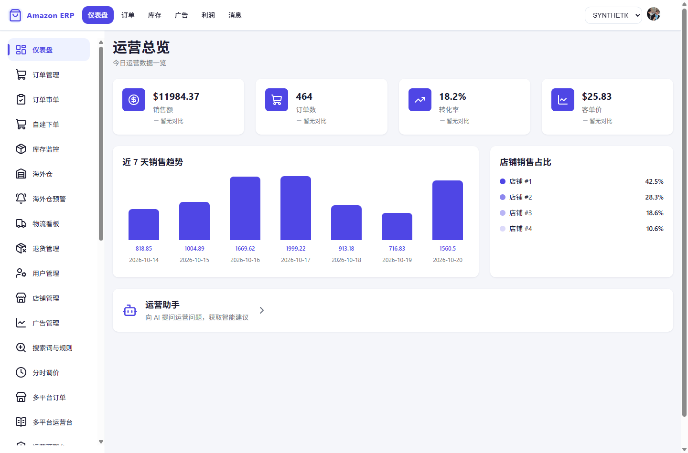
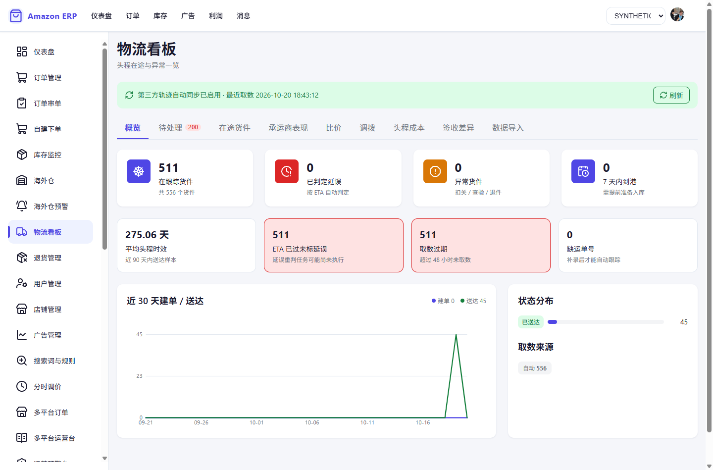

# Amazon ERP

亚马逊卖家全链路 ERP：七个业务域、29 个 AI 工具、店铺级数据隔离的 Spring Cloud + Vue 3 微服务平台。

> [!IMPORTANT]
> **当前进度：代码与 CI 全绿，尚未完成真实 Amazon 账号联调。**
> SP-API、Ads、DeepSeek、Keepa 等外部凭据未配置，因此「可直接生产部署」以完成沙箱/生产联调为前提。
> 本文所有模块与端点描述均指**代码路径已具备**，不代表外部平台已真实对接。
> 无凭据环境下可用 `mock` profile 启动，见[快速开始](#快速开始)。



<details>
<summary>物流看板截图</summary>



</details>

## 解决什么问题

跨境卖家通常同时管多个站点、多店铺、多平台，日常要回答三类问题：

1. **现在赚不赚钱** —— 收入与费用以平台实际扣费为准（非估算），成本缺失时显式标记「利润不完整」，而不是按 0 计给你一个好看的数字。
2. **货会不会断** —— 补货引擎综合日均销量、安全系数、季节性与促销因子，CV 高时用 LightGBM + 规则混合推理。
3. **路上的货出了什么状况** —— 物流看板让异常主动浮现（ETA 已过未标延误、取数过期、缺运单号），而不是等运营逐条点同步。

## 快速开始

需要 Docker Compose 与 JDK 17 + Maven 3.8+。

```bash
git clone https://github.com/cgs123456/AmazonERP.git && cd AmazonERP
cp .env.example .env          # 编辑必填项：DB_PASSWORD、REDIS_PASSWORD、JWT_SECRET_KEY、AMZ_CRYPTO_KEY
docker compose up -d          # 15 个基础设施 + 16 个 Spring 服务 + 前端
```

业务表由各服务 Flyway 自建（101 张表的唯一事实源），`docker/init-sql/` 只创建 14 个空库。服务启动后访问前端（默认 5173）。

离线演示用 `SPRING_PROFILES_ACTIVE=mock`：外部客户端返回确定性样例数据，无需任何 Amazon 凭据。
`prod` 与 `mock` **不可混用**——`ProductionProfileGuard` 会拒绝启动，这是为了防止「以为在跑真实链路、实际拿到桩数据」。

### 没有真实数据时的演示

`tools/synthetic-data/` 提供确定性模拟数据集（101 张表 / 22 万行），可生成、可加载、可清理、可识别，全程不需要任何亚马逊凭证和网络：

```bash
cd tools/synthetic-data
python generate.py --tier demo --reset     # 生成 101 张表 / 224,858 行
./load.ps1 -Tier demo -Container amz-mysql # 灌入 MySQL
```

模拟数据带 `SYNTHETIC` 标记并登记到 `amz_ops.amz_synthetic_dataset_registry`，**不是** SP-API 联调证据。

## 主要能力

| 域 | 说明 |
|---|---|
| **订单** | SP-API 同步、B2C 自建单、智能审单、退货 RMA |
| **库存** | FBA 健康度分级（STOCKOUT/URGENT/AT_RISK/HEALTHY/OVERSTOCK）、海外仓、智能补货 |
| **广告** | ACoS、搜索词、自动规则、分时调价、日报 02:00 同步 |
| **物流** | 双入口取数、比价、调拨、头程分摊、签收差异（9 标签页看板） |
| **财务** | 结算原表取数、回款台账、费用差异、索赔、真实利润（复式记账 + 金蝶 + VAT） |
| **采购** | 供应商、1688、FBA 货件 |
| **多平台** | Temu / TikTok Shop / SHEIN 的订单、消息、库存同步 |
| **AI Agent** | 29 个工具（查询/分析/优化/执行四类）+ 店铺知识库 RAG + SSE 流式问答 |
| **连接器** | 90 条 SP-API 已实现能力，A1–A8 证据等级可视化自检 |

完整端点清单见代码（60 个 Controller / 357 个端点）与 [docs/superpowers/](docs/superpowers/)。

## 安全模型

- **店铺隔离**：`@ShopScoped` 切面 + 服务层显式校验双轨。以资源 ID 为入参的端点（`/transfer/{id}/approve` 等）切面够不着，归属校验落在 Service 内部，提示语统一为「不存在或无权访问」以免借接口探测他店数据
- **角色门禁**：读接口 VIEWER 可查，写接口一律 `@RequireRole({OPERATOR, ADMIN})`
- **凭证加密**：`AMZ_CRYPTO_KEY` AES-256-GCM；缺密钥 `CryptoUtil` 拒绝启动
- **LWA Token 隔离**：缓存键含 `sha256(refreshToken)`，杜绝跨租户串号
- **启动 fail-closed**：缺凭证、占位密码、`prod`+`mock` 混用均拒绝启动

完整防护层清单（字段级权限、JWT 双 Token、DLX、分布式锁、SQL 注入防护等 20 项）见 [HANDOFF.md](HANDOFF.md)。

## 测试

| 层级 | 用例数 | 说明 |
|---|---|---|
| 后端 JUnit 5 | 2531 | 19/19 模块 BUILD SUCCESS |
| 前端 Vitest | 725 | 55/55 文件通过 |
| Playwright E2E | 185 | chromium 串行，全过 |

本机 Windows 上有 3 个用例因 JDK 的 `UnixDomainSockets` 无法建立 loopback 而恒定失败（`AdvertisingApiRealClientContractTest`、`OrderServiceFeignDecodeIT`、`DeepSeekAgentConfigurationContractTest`），同一批代码在 CI（Linux）全绿。判定回归的方法是**看失败集合是否超出这三个**。

## 文档

- [HANDOFF.md](HANDOFF.md) —— 架构决策记录、各轮变更、已知限制（主文档）
- [docs/superpowers/specs/](docs/superpowers/specs/) —— 生产设计文档
- [docs/superpowers/runbooks/](docs/superpowers/runbooks/) —— 首次部署、凭证导入、连接器联调、发布回滚
- [docs/superpowers/plans/](docs/superpowers/plans/) —— 实施计划

外部凭据接入（SP-API / Ads）不是「填个 key 就能用」：还需要 LWA 授权、应用审批、角色权限、marketplace 与端点版本对账、沙箱联调。步骤见 [amazon-ads-api-onboarding-runbook.md](docs/superpowers/runbooks/amazon-ads-api-onboarding-runbook.md)。

## 技术栈

Java 17 / Spring Boot 3.3.5 / Spring Cloud 2023.0.3 / MyBatis-Plus 3.5.7 / MySQL 8.0.33 / Redis 7.0 / RabbitMQ 3.12 / Elasticsearch 9.2.8 / MongoDB 7.0 / LangChain4j 0.36.2 / ONNX Runtime 1.18.2 / Vue 3.5.13

前端不使用第三方 UI 库：全部控件为原生 HTML + 自建设计 token 体系（`style.css`），图标用 Lucide 本地打包（离线部署不出现空白图标）。2026-10-20 评估过 shadcn-vue，实测视觉差异小于迁移风险后已完整移除，过程见 HANDOFF。

## License

MIT
